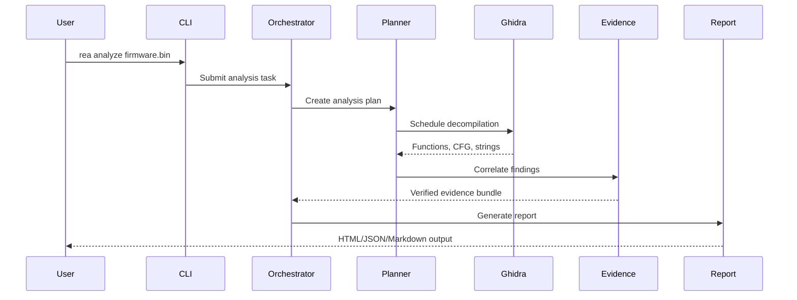

# REA Demo - Reverse Engineering Agent Demonstration

[](https://github.com/shivam31bharti-arch/REA/stargazers)
[](https://github.com/shivam31bharti-arch/REA/network)
[](LICENSE)
[](https://www.typescriptlang.org/)
[](https://nodejs.org/)
[](https://www.electronjs.org/)

> A comprehensive demonstration of **REA (Reverse Engineering Agent)** — an autonomous agent framework for binary analysis, reverse engineering, and software comprehension.

---

## 📋 Table of Contents

- [Overview](#-overview)
- [Architecture](#-architecture)
- [Project Structure](#-project-structure)
- [Components](#-components)
- [Getting Started](#-getting-started)
- [Demo Scripts](#-demo-scripts)
- [Technology Stack](#-technology-stack)
- [Development](#-development)
- [Contributing](#-contributing)
- [License](#-license)

---

## 🎯 Overview

This repository contains a complete demonstration environment for **REA (Reverse Engineering Agent)**, showcasing:

- **Automated binary analysis** across multiple architectures (x86, ARM, MIPS, RISC-V, PowerPC, 6502, m68k)
- **Multi-tool orchestration** (Ghidra, IDA Pro, Hopper, Binary Ninja, radare2, Frida, apktool, JADX)
- **Evidence-based reasoning** with verifiable findings
- **Real-time collaboration** via MCP (Model Context Protocol)
- **Cross-platform support** (Windows, Linux, macOS, Android)

### What is REA?

REA is an autonomous agent that performs reverse engineering tasks by:
1. **Discovering** binaries and firmware images
2. **Analyzing** them using multiple complementary tools
3. **Correlating** findings across tool outputs
4. **Producing** evidence-backed reports with citations

---

## 🏗️ Architecture

```mermaid
graph TB
    subgraph "User Interface"
        CLI[CLI Interface]
        Web[Web Dashboard]
        MCP[MCP Server]
    end

    subgraph "Core Agent"
        Orchestrator[Orchestrator]
        Planner[Task Planner]
        Evidence[Evidence Engine]
    end

    subgraph "Analysis Engines"
        Ghidra[Ghidra Bridge]
        IDA[IDA Pro Bridge]
        Hopper[Hopper Bridge]
        Binja[Binary Ninja Bridge]
        Radare[radare2 Bridge]
        Frida[Frida Bridge]
        APKTool[apktool]
        JADX[JADX]
    end

    subgraph "Specialized Analyzers"
        Android[Android Analyzer]
        Firmware[Firmware Analyzer]
        DotNet[.NET Analyzer]
        Go[Go Analyzer]
        Rust[Rust Analyzer]
        EVM[EVM Analyzer]
        Wasm[WASM Analyzer]
    end

    subgraph "Infrastructure"
        Capture[Network Capture]
        Sandbox[Execution Sandbox]
        Cache[Artifact Cache]
        Telemetry[Telemetry]
    end

    CLI --> Orchestrator
    Web --> Orchestrator
    MCP --> Orchestrator
    Orchestrator --> Planner
    Orchestrator --> Evidence
    Planner --> Ghidra
    Planner --> IDA
    Planner --> Hopper
    Planner --> Binja
    Planner --> Radare
    Planner --> Frida
    Planner --> APKTool
    Planner --> JADX
    Planner --> Android
    Planner --> Firmware
    Planner --> DotNet
    Planner --> Go
    Planner --> Rust
    Planner --> EVM
    Planner --> Wasm
    Orchestrator --> Capture
    Orchestrator --> Sandbox
    Orchestrator --> Cache
    Orchestrator --> Telemetry
```



### Data Flow



---

## 📁 Project Structure

```
REA/
├── .claude/                    # Claude Code configuration
├── broll/                      # Video assets for demos
│   ├── openpage-part.mp4
│   └── openpage-shots/
├── Demo Files/                 # Sample documents
│   ├── Channel-Report-Q3.docx
│   └── Sponsor-tracker.xlsx
├── openpage-demo/              # Electron demo application
│   ├── main.js                 # Main process
│   ├── preload.js              # Preload script
│   ├── renderer/               # Renderer process
│   │   ├── index.html
│   │   ├── app.js
│   │   ├── styles.css
│   │   └── find-replace.js
│   ├── scripts/
│   │   └── pack.mjs            # Build script
│   ├── package.json
│   └── REA-DEMO.md
├── paperlight/                 # Paperlight - Notebook/IDE application
│   ├── src/
│   │   ├── apps/
│   │   │   ├── cells/          # Spreadsheet app
│   │   │   ├── deck/           # Presentation app
│   │   │   ├── jotbook/        # Notebook app
│   │   │   └── prose/          # Document editor
│   │   ├── editor/             # Core editor (TipTap-based)
│   │   ├── shell/              # Application shell
│   │   ├── lib/                # Shared libraries
│   │   └── main.tsx
│   ├── electron/               # Electron main/preload
│   ├── release/                # Build outputs (gitignored)
│   ├── .impeccable/            # Design system & review assets
│   ├── package.json
│   ├── tsconfig.json
│   └── vite.config.ts
├── rea/                        # REA Core (submodule)
│   ├── src/                    # TypeScript source
│   │   ├── main.ts             # Entry point
│   │   ├── cli.ts              # CLI commands
│   │   ├── config.ts           # Configuration
│   │   ├── application/        # Application layer
│   │   ├── domain/             # Domain models
│   │   ├── composition/        # Dependency injection
│   │   └── ...                 # 30+ packages
│   ├── scripts/                # Build & release scripts
│   ├── tests/                  # Test suites
│   ├── website/                # Documentation site
│   ├── third_party/            # Vendored tools
│   └── package.json
├── script/                     # Demo scripts
│   ├── setup-script.md
│   ├── clean-script.md
│   └── full-script.md
├── tools/                      # External tools (gitignored)
│   ├── ghidra_12.1.4_PUBLIC/
│   └── jdk-21/
└── .gitignore
```

---

## 🧩 Components

### 1. REA Core (`rea/`)

The main agent framework with:

| Package | Purpose |
|---------|---------|
| `application` | Use cases & application services |
| `domain` | Core domain models (Binary, Function, Finding, Evidence) |
| `composition` | Dependency injection container |
| `cli` | Command-line interface |
| `config` | Configuration management |
| `ghidra` | Ghidra bridge & decompilation |
| `ida` | IDA Pro integration |
| `hopper` | Hopper disassembler bridge |
| `binja` | Binary Ninja API |
| `radare` | radare2 / rizin integration |
| `frida` | Dynamic instrumentation |
| `android` | APK/AAB analysis |
| `firmware` | Firmware extraction & analysis |
| `dotnet` | .NET assembly analysis |
| `go` | Go binary analysis |
| `rust` | Rust binary analysis |
| `evm` | Ethereum bytecode analysis |
| `wasm` | WebAssembly analysis |
| `cutter` | Cutter GUI integration |
| `browser` | Browser-based analysis |
| `capture` | Network traffic capture |
| `signals` | Signal processing |
| `evaluation` | Benchmark & evaluation |

### 2. Paperlight (`paperlight/`)

A modern Electron-based productivity suite demonstrating REA's UI capabilities:

- **Cells** — Reactive spreadsheet with formula engine
- **Deck** — Presentation builder with Reveal.js export
- **Jotbook** — Hierarchical notebook with search
- **Prose** — Rich text editor with slash commands
- **Dashboard** — Unified workspace

### 3. OpenPage Demo (`openpage-demo/`)

Lightweight Electron demo showing REA's web integration.

---

## 🚀 Getting Started

### Prerequisites

| Tool | Version | Purpose |
|------|---------|---------|
| Node.js | 20+ | Runtime |
| pnpm | 9+ | Package manager |
| Git | 2.40+ | Version control |
| Ghidra | 11.0+ | Static analysis |
| JDK | 21 | Ghidra runtime |

### Installation

```bash
# Clone with submodules
git clone --recurse-submodules https://github.com/shivam31bharti-arch/REA.git
cd REA

# Install dependencies
cd rea && pnpm install
cd ../paperlight && pnpm install
cd ../openpage-demo && npm install
```

### Tool Setup

```bash
# Download Ghidra (if not present)
# https://ghidra-sre.org/ → tools/ghidra_12.1.4_PUBLIC/

# Download JDK 21
# https://adoptium.net/ → tools/jdk-21/

# Verify setup
cd rea && pnpm run doctor
```

---

## 🎬 Demo Scripts

### Setup Demo
```bash
cat script/setup-script.md
```
Shows environment preparation, tool installation, and configuration.

### Clean Demo
```bash
cat script/clean-script.md
```
Demonstrates clean analysis workflow on a sample binary.

### Full Demo
```bash
cat script/full-script.md
```
Complete end-to-end demonstration including:
- Firmware extraction
- Multi-tool analysis
- Evidence correlation
- Report generation

---

## 🛠️ Technology Stack

### Core
| Category | Technologies |
|----------|--------------|
| **Language** | TypeScript 5.0+, Python 3.11+ |
| **Runtime** | Node.js 20+, Bun 1.0+ |
| **Framework** | Electron 28, Vite 5, Vitest |
| **UI** | React 18, TipTap, Radix UI, Tailwind CSS |
| **State** | Zustand, TanStack Query |

### Reverse Engineering
| Tool | Integration |
|------|-------------|
| Ghidra | Headless analyzer + bridge |
| IDA Pro | IDC/Python scripting |
| Hopper | Python API |
| Binary Ninja | Python API |
| radare2/rizin | r2pipe |
| Frida | JavaScript API |
| apktool | CLI wrapper |
| JADX | CLI + dex2jar |
| Binwalk | Firmware extraction |

### Infrastructure
| Component | Technology |
|-----------|------------|
| **Protocol** | MCP (Model Context Protocol) |
| **Serialization** | Protocol Buffers, JSON |
| **Storage** | SQLite, IndexedDB |
| **Networking** | WebSocket, HTTP/3 |
| **Observability** | OpenTelemetry, Prometheus |

---

## 💻 Development

### Commands

```bash
# REA Core
cd rea
pnpm run build          # Compile TypeScript
pnpm run test           # Run tests
pnpm run lint           # ESLint + Prettier
pnpm run typecheck      # TypeScript check
pnpm run doctor         # Environment verification

# Paperlight
cd paperlight
pnpm run dev            # Development server
pnpm run build          # Production build
pnpm run package        # Electron package

# OpenPage Demo
cd openpage-demo
npm run dev             # Development
npm run build           # Build
```

### Testing

```bash
# Unit tests
cd rea && pnpm run test:unit

# Integration tests
cd rea && pnpm run test:integration

# E2E tests
cd rea && pnpm run test:e2e

# Conformance tests
cd rea && pnpm run test:conformance
```

### Code Quality

```bash
# Lint all
pnpm run lint:all

# Format
pnpm run format

# Type check
pnpm run typecheck:all
```

---

## 🤝 Contributing

1. Fork the repository
2. Create a feature branch: `git checkout -b feature/amazing-feature`
3. Commit changes: `git commit -m 'Add amazing feature'`
4. Push to branch: `git push origin feature/amazing-feature`
5. Open a Pull Request

### Guidelines

- Follow TypeScript strict mode
- Write tests for new functionality
- Update documentation
- Follow conventional commits
- Ensure CI passes

---

## 📄 License

This project is licensed under the **MIT License** — see [LICENSE](LICENSE) for details.

---

## 🔗 Links

- **REA Documentation**: [https://rea.dev](https://rea.dev)
- **Ghidra**: [https://ghidra-sre.org](https://ghidra-sre.org)
- **MCP Specification**: [https://modelcontextprotocol.io](https://modelcontextprotocol.io)
- **Paperlight**: [https://paperlight.dev](https://paperlight.dev)

---

## 🙏 Acknowledgments

- **NSA** for Ghidra
- **Hex-Rays** for IDA Pro
- **Binary Ninja** team
- **radare2/rizin** community
- **Frida** contributors
- **Electron** team
- **TipTap** for the editor framework

---

<div align="center">

**Built with ❤️ for the reverse engineering community**

[⬆ Back to Top](#rea-demo---reverse-engineering-agent-demonstration)

</div>